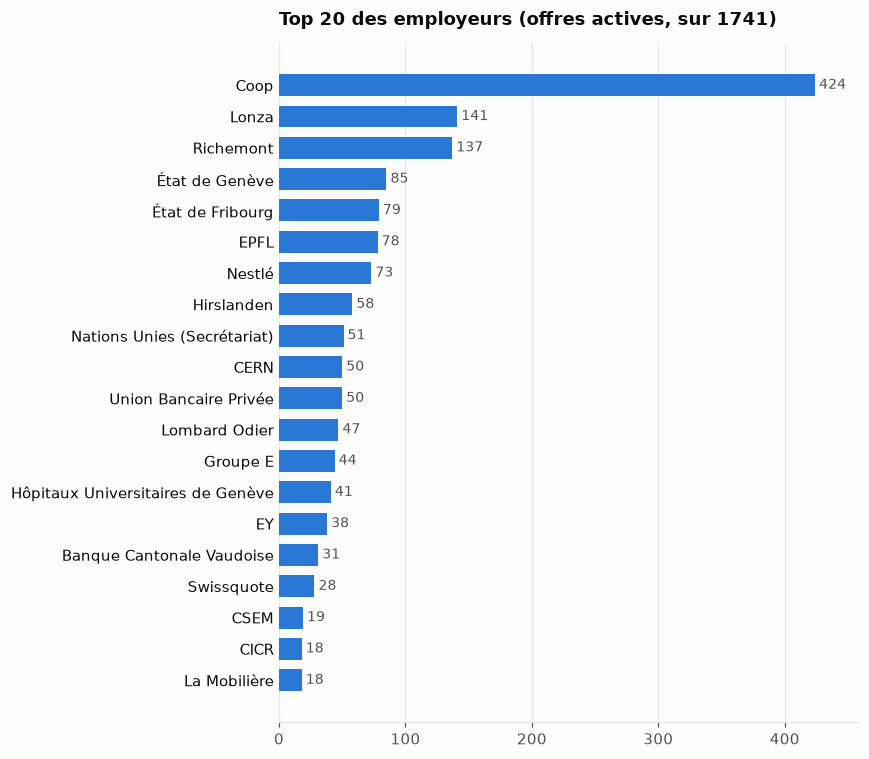
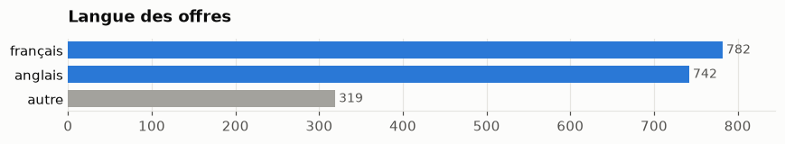

# job-rec-ai

**Un moteur open-source de recommandation d'emplois à partir d'un CV.**

Collecte d'offres réelles (Genève d'abord, puis toute la Suisse), embeddings multilingues FR/EN,
recherche sémantique, re-ranking et apprentissage à partir de swipes : un « Tinder des jobs »
construit étape par étape, comme projet d'apprentissage en data engineering et data science.

## Avancement

Voir **[ROADMAP.md](ROADMAP.md)** : 9 étapes, chacune validée par des tests d'acceptation
(`checkpoints/`).
Où on en est, et les décisions prises : **[PROGRESS.md](PROGRESS.md)**.

| Étape | Statut |
|---|---|
| M0 · Setup | 🚧 en cours |
| M1 · Collecte | 🚧 1 692 offres réelles en Suisse romande francophone ; notes et questions de contrôle restantes |
| M2 · Pipeline | 🚧 collecte nocturne sur le VPS à installer |
| M3 · Baseline et évaluation | ⏳ |
| M4 · Embeddings et recherche sémantique | ⏳ |
| M5 · Enrichissement par LLM | ⏳ |
| M6 · Re-ranking | ⏳ |
| M7 · Feedback et swipe | ⏳ |
| M8 · Production | ⏳ |

## Le marché romand en images

1 884 offres actives collectées chez 59 employeurs de Suisse romande et une agence
(5 novembre 2026 ; Genève et Vaud seulement jusque-là). Les graphiques et leur lecture :
[`notebooks/marche-emploi.ipynb`](notebooks/marche-emploi.ipynb).





## Utilisation

```bash
uv run job-rec-ai boards                       # quels ATS couvrent quelles entreprises
uv run job-rec-ai crawl                        # collecte en Suisse romande → data/jobs.duckdb
uv run job-rec-ai stats company family         # répartition des offres actives
uv run job-rec-ai quality                      # champs vides, collectes en échec
uv run job-rec-ai search --canton GE --family "Data & IA" --sort recent --urls
uv run job-rec-ai explore                      # page HTML des offres → data/offres.html
uv run job-rec-ai recommend                    # offres les plus proches du CV (BM25), data/private/cv.pdf
uv run job-rec-ai eval --pool                   # offres à noter → data/private/eval/annoter-leif.html
uv run job-rec-ai eval                          # P@10, MRR, nDCG@10 par méthode
uv run --env-file .env job-rec-ai benchmark    # couverture comparée à Adzuna
uv run job-rec-ai backfill-markdown            # annonces en Markdown depuis data/raw (sans réseau)
```

Les entreprises suivies sont dans [`data/companies.csv`](data/companies.csv).
Collecte nocturne sur un VPS : voir [`deploy/`](deploy/README.md).

## API

`uv run uvicorn job_rec_ai.api:app` (base : `JOB_REC_DB`, jeton facultatif : `JOB_REC_TOKEN`,
envoyé en `Authorization: Bearer …` sur toutes les routes sauf `/health`).

| Route | Rôle |
|---|---|
| `GET /health` | le service répond (sans jeton) |
| `GET /status` | offres indexées, date de chargement de la base |
| `POST /recommend` | `{cv_text, k, cantons}` → les offres les plus proches du CV (BM25) |
| `GET /jobs` | liste cherchable : `q` (BM25), `cantons`, taux, ancienneté, pagination, facettes par canton |
| `GET /jobs/{id}` | une offre, avec l'annonce en Markdown (titres, listes, gras gardés) |
| `GET /jobs/{id}/similar` | les offres les plus proches de celle-ci |

`id` = 16 caractères hexadécimaux du SHA-256 de l'URL de l'offre. Contrat complet (paramètres,
formes des réponses, erreurs) : [docs/integration-doxai.md](docs/integration-doxai.md).

## Structure

```
src/job_rec_ai/     le moteur (créé à l'étape M0) et l'API (api.py, catalog.py, markdown.py)
checkpoints/        tests d'acceptation de chaque étape de la roadmap
docs/learnings/     modèle des notes personnelles (les notes vivent dans Notion, privées)
```

## Licence

MIT (à confirmer)
